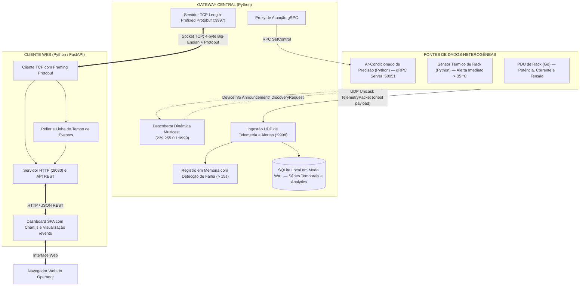

# DataMesh DCIM — Gestão de Ambiente Inteligente em Data Center

**Monitoramento Térmico, Telemetria Elétrica e Controle de Climatização Distribuído em Tempo Real**

Projeto prático desenvolvido para a disciplina de **Sistemas Distribuídos / Distribuição de Processos e Dados** (Universidade Federal do Ceará — UFC, Prof. Dr. Paulo A. L. Rego). O **DataMesh DCIM** (*Data Center Infrastructure Management*) instancia uma arquitetura distribuída heterogênea (Python e Go) voltada à supervisão contínua de racks de servidores, detecção imediata de anomalias térmicas, agregação analítica de séries temporais em SQLite e atuação remota em equipamentos de climatização de precisão utilizando **Sockets TCP/UDP**, **UDP Multicast**, **Protocol Buffers (v3)** e **gRPC**.

### Membros da Equipe

- **Antonio Gabriel Carmo Rego** — Matrícula: `539628`
- **Lucas Lopes de Sousa** — Matrícula: `537512`

### Sumário

- [1. Arquitetura](#1-arquitetura)
- [2. Módulos](#2-módulos)
  - [Contrato Protocol Buffers e Framing TCP (`proto/` & `common/`)](#21-contrato-protocol-buffers-e-framing-tcp-proto--common)
  - [Gateway Central (`gateway/`)](#22-gateway-central-gateway)
  - [Ar-Condicionado de Precisão (`sources/ac/`)](#23-ar-condicionado-de-precisão-sourcesac)
  - [Sensor de Temperatura de Rack (`sources/temperature/`)](#24-sensor-de-temperatura-de-rack-sourcestemperature)
  - [PDU de Rack em Go (`sources/pdu/`)](#25-pdu-de-rack-em-go-sourcespdu)
  - [Cliente Web e Dashboard (`client/`)](#26-cliente-web-e-dashboard-client)
- [3. Execução e Demonstração](#3-execução-e-demonstração)
- [4. Verificação, Testes e Qualidade](#4-verificação-testes-e-qualidade)

---

# 1. Arquitetura

O sistema é dividido em três camadas estritamente desacopladas (**Fontes de Dados**, **Gateway Central** e **Cliente**), onde **100% do tráfego de rede é tipado e serializado via Protocol Buffers**:



### Protocolos e Padrões Adotados

- **UDP Multicast (`239.255.0.1:9999`):** O Gateway emite periodicamente beacons `DiscoveryRequest` contendo seu IP e porta de ingestão UDP; as fontes ativas respondem anunciando seu `DeviceInfo` (ID, tipo, IP, porta gRPC e estado inicial).
- **UDP Unicast (`:9998`):** Transporte leve e de baixa sobrecarga para o envio periódico de pacotes `TelemetryPacket` e disparos prioritários orientados a eventos (anomalias térmicas `> 35 °C`).
- **gRPC (`:50051`):** Invocação remota de procedimentos (`AirConditionerService.SetControl`) do Gateway para os atuadores de climatização.
- **TCP com Framing *Length-Prefixed* (`:9997`):** Toda comunicação entre o processo Cliente e o Gateway ocorre sobre sockets TCP puros com cabeçalho explícito de 4 bytes (`uint32` *big-endian*) indicando o tamanho exato do payload Protobuf (`ClientRequest` / `ClientResponse`).

---

# 2. Módulos

## Sobre os Módulos

### 2.1. Contrato Protocol Buffers e Framing TCP (`proto/` & `common/`)
>
> Define a linguagem única de comunicação entre os processos em Python e Go, utiliza união polimórfica (`oneof`) para telemetrias heterogêneas e implementa a delimitação segura de mensagens em fluxos TCP.

- **`proto/datamesh.proto`:** Centraliza todas as mensagens e enums do domínio:
  - *Descoberta e Topologia:* `DiscoveryRequest`, `DeviceInfo` e enum `DeviceType` (`TEMPERATURE_SENSOR`, `RACK_PDU`, `AIR_CONDITIONER`).
  - *Telemetria com `oneof payload`:* O pacote unificado `TelemetryPacket` contém os metadados comuns (`device_id`, `device_type`, `timestamp_ms`, `is_alert`) e encapsula polimorficamente o payload específico de cada dispositivo via `oneof payload`:
    - `TemperatureTelemetry`: leitura de temperatura em graus Celsius (`temperature_c`).
    - `ACTelemetry`: leituras térmicas e operacionais (`temperature_c`, `target_temp_c`, `fan_speed_pct`, `power_watts`, `current_amps`, `voltage_volts`, `ac_power_on`).
    - `PDUTelemetry`: leituras elétricas do rack (`power_watts`, `current_amps`, `voltage_volts`).
    *Vantagem arquitetural:* elimina campos nulos ou ambíguos na serialização, garantindo tipagem estrita tanto em Python quanto em Go.
  - *Controle gRPC:* Serviço `AirConditionerService` com RPC `SetControl(ACControlRequest) returns (ACControlResponse)`.
  - *Sessão Cliente-Gateway e Analytics:* `ClientRequest`, `ClientResponse`, `AnalyticsResult` e os 3 tipos de consulta `AnalyticsQueryType` (`HOTTEST_RACK`, `AVG_PDU_POWER`, `THERMAL_STABILITY`).
- **`common/framing.py`:** Implementa `send_proto` e `recv_proto` utilizando `struct.pack(">I", length)` (4 bytes *big-endian*) e leitura exata de buffer (`_recv_exact`), prevenindo fragmentação ou concatenação de pacotes em streams TCP.

### 2.2. Gateway Central (`gateway/`)
>
> Atua como ponto central de coordenação, registro de estado de dispositivos, persistência histórica e roteamento de comandos.

- **Registro de Dispositivos e Falha Passiva (`gateway/registry.py`):** Mantém o estado em memória (`DeviceRegistry`) thread-safe. Calcula dinamicamente `is_online` comparando o timestamp atual com `last_seen_ms`: caso uma fonte fique **mais de 15 segundos** (`OFFLINE_THRESHOLD_MS = 15_000`) sem enviar pacotes UDP, é marcada automaticamente como `OFFLINE`.
- **Persistência SQLite e Motor Analítico (`gateway/storage/`):** Armazena séries temporais em SQLite com modo **WAL (`PRAGMA journal_mode=WAL`)** habilitado para leitura e escrita concorrentes. Executa diretamente via SQL as 3 consultas agregadas em janela deslizante:
  1. `HOTTEST_RACK`: Identifica o sensor de rack com o maior pico térmico registrado no período (`MAX(temperature_c)`).
  2. `AVG_PDU_POWER`: Calcula o consumo médio de potência ativa em Watts das PDUs (`AVG(power_watts)`).
  3. `THERMAL_STABILITY`: Calcula a média e o desvio padrão populacional das temperaturas dos racks para medir a estabilidade térmica do ambiente.
- **Coordenador e Proxy gRPC (`gateway/service.py` & `gateway/proxy.py`):** Gerencia em threads dedicadas o listener UDP de ingestão, o emissor de beacons UDP Multicast, o servidor TCP multi-cliente e o stub gRPC (`GrpcACControlProxy`) para repassar atuações ao Ar-Condicionado.

### 2.3. Ar-Condicionado de Precisão (`sources/ac/`)
>
> Fonte **controlável** em Python que combina atuação via servidor gRPC e telemetria contínua via UDP.

- **`sources/ac/actuator.py`:** Levanta um servidor gRPC (`AirConditionerServicer`) na porta `:50051` que processa comandos `SetControl` alterando atomicamente estado de energia (`power_on`), temperatura alvo (`target_temp_c`) e rotação da ventoinha (`fan_speed_pct`).
- Simula a convergência térmica gradual do ambiente em direção ao *setpoint* configurado (ou deriva para a temperatura ambiente quando desligado) e calcula o consumo elétrico proporcional à velocidade dos ventiladores.
- Escuta beacons no grupo multicast `239.255.0.1:9999` (com `SO_REUSEADDR`/`SO_REUSEPORT`) e transmite periodicamente seu estado via UDP ao Gateway.

### 2.4. Sensor de Temperatura de Rack (`sources/temperature/`)
>
> Fonte **orientada a eventos** em Python com telemetria periódica e disparo imediato de anomalias térmicas (`> 35 °C`).

- **`sources/temperature/sensor.py`:** Permite configurar a temperatura base nominal de cada rack (`BASE_TEMP_C`) e envia leituras periódicas via UDP unicast.
- **Disparo Imediato de Evento Crítico:** Ao receber um gatilho (via tecla `[ENTER]` no terminal ou sinal `SIGUSR1` enviado pelo console da demonstração), invoca `trigger_anomaly(temp_c=38.8)` — transmitindo **imediatamente** um pacote UDP com `is_alert=True` sem aguardar o temporizador periódico. O rack permanece quente por um platô (`ANOMALY_HOLD_SEC`, padrão 20 s) para visualização clara no Dashboard e depois resfria exponencialmente até a temperatura base (`ANOMALY_DECAY_SEC`, padrão 10 s); o alerta só é desligado abaixo de 33 °C (histerese) para não oscilar em torno do limiar.

### 2.5. PDU de Rack em Go (`sources/pdu/`)
>
> Fonte **contínua** implementada em **Go** para demonstrar interoperabilidade multi-linguagem via Protocol Buffers.

- **`sources/pdu/pdu.go` & `cmd/main.go`:** Compilado como binário nativo em Go utilizando os pacotes gerados em `gen/go`.
- Participa da descoberta UDP Multicast (`net.ListenMulticastUDP`) aprendendo dinamicamente o endereço do Gateway e emite continuamente leituras de potência ativa (`Watts`), corrente (`Amperes`) e tensão (`Volts`) serializadas em Protobuf via UDP.

### 2.6. Cliente Web e Dashboard (`client/`)
>
> Processo independente em Python (`FastAPI`) que atua como adaptador entre o navegador e o socket TCP do Gateway.

- **`client/gateway_client.py` (`TCPGatewayClient`):** Realiza todas as operações (`list_devices`, `get_history`, `control_ac`, `query_analytics`) abrindo conexões TCP com framing Protobuf de 4 bytes contra o Gateway (`:9997`). O Cliente Web **nunca** acessa o banco SQLite nem se comunica diretamente com as fontes.
- **`client/static/index.html`:** Dashboard single-page com `Chart.js` e atualização automática a cada 2s:
  - Agrupa os dispositivos conectados em **3 categorias visuais** (*Climatização AC*, *Sensores Térmicos de Rack* e *PDUs de Rack*).
  - Destaca imediatamente em vermelho (`🔥 ALERTA (>35°C)`) sensores em estado de anomalia térmica e sinaliza fontes inativas (`OFFLINE (>15s)`).
  - Exibe gráficos em tempo real de séries temporais térmicas e elétricas, painel de controle gRPC do AC e execução interativa das 3 consultas analíticas.
- **`client/events.py` & `client/static/events.html` (`/events`):** Linha do tempo de eventos com filtros por categoria — fontes registradas no Gateway, transições `ONLINE`/`OFFLINE`, início e fim de alertas térmicos (com o timestamp do próprio pacote), comandos gRPC enviados ao AC e consultas analíticas executadas. Os eventos são detectados no processo do Cliente por uma thread que consulta o Gateway via TCP a cada 1s, então o histórico cobre toda a demonstração mesmo que a página seja aberta depois.

---

# 3. Execução e Demonstração

### Pré-requisitos

- **Python 3.12+** (gerenciado via `uv`) e **Go 1.23+** (gerenciado via `mise`).
- Instalar dependências (caso necessário):

  ```bash
  mise install && uv sync
  ```

### Opção A — Console Interativo de Demonstração (Recomendado)

O script [scripts/run_demo.sh](file:///home/gabrigas/Selene/UFC/sistemas%20distribuidos/1%20-%20atividades/datamesh/scripts/run_demo.sh) compila o binário Go da PDU, sobe o Gateway, o Cliente Web (`http://localhost:8080`) e uma topologia **multi-rack** inicial com codinomes estilo Docker (`ac-01-carnot`, `temp-01-turing`, `temp-02-curie`, `pdu-01-tesla`, `pdu-02-faraday`), exibindo um menu interativo no terminal:

```bash
./scripts/run_demo.sh
# ou via Taskfile:
mise exec -- task demo
```

Ações disponíveis no console interativo durante a demonstração:

- **`[1]` 🔥 Disparar anomalia térmica imediata (`> 35°C`):** permite escolher qualquer sensor térmico ativo para disparar instantaneamente um alerta crítico (`38.8 °C [ALERTA]`) ao Gateway.
- **`[2]` ➕ Adicionar novo sensor/PDU ao vivo:** instancia novos processos em tempo de execução com codinomes autogerados estilo Docker (ex.: `temp-03-frosty-fermi`, `pdu-03-amber-lovelace`), demonstrando a entrada dinâmica de fontes no Dashboard.
- **`[3]` 💥 Simular falha/desligamento de uma fonte (`ONLINE -> OFFLINE`):** encerra o processo da fonte escolhida; após 15 segundos sem telemetria UDP, o Gateway altera seu estado para `OFFLINE (>15s)`.
- **`[4]` 🔄 Religar/recuperar uma fonte parada (`OFFLINE -> ONLINE`):** reinicia uma fonte previamente derrubada, restabelecendo o fluxo UDP e o status `ONLINE`.
- **`[5]` 📊 Listar estado atual dos processos da Demo.**
- **`[6]` 📜 Exibir últimas 15 linhas de log (`/tmp/datamesh-demo.log`).**
- **`[q]` 🚪 Encerrar demonstração:** finaliza todos os processos filhos e limpa arquivos temporários.

### Opção B — Execução Manual em Terminais Separados

```bash
# Terminal 1 — Gateway Central (TCP :9997, UDP :9998, Multicast 239.255.0.1:9999)
uv run python -m gateway.main

# Terminal 2 — Ar-Condicionado de Precisão (Servidor gRPC :50051 + Telemetria UDP)
uv run python -m sources.ac.main

# Terminal 3 — Sensor de Temperatura de Rack (Pressione [ENTER] para disparar > 35°C)
uv run python -m sources.temperature.main

# Terminal 4 — PDU de Rack (Go)
mise exec -- go run ./sources/pdu/cmd/main.go

# Terminal 5 — Cliente Web (Dashboard em http://localhost:8080)
uv run python -m client.main
```

---

# 4. Verificação, Testes e Qualidade

O projeto conta com suíte automatizada de testes unitários e de integração ponta a ponta (93 testes Python com requisito mínimo de **80% de cobertura**, atingindo **88.42%**, e 10 testes Go), além de checagem estrita de tipos (`ty` da Astral e `go vet`) e formatação (`ruff` e `gofmt`):

```bash
# Executar pipeline completo de validação (proto -> lint -> typecheck -> tests)
mise exec -- task check

# Executar apenas a suíte Python com relatório de cobertura (93 testes, 88.42% coverage)
uv run pytest

# Executar apenas a suíte de testes Go da PDU (10 testes)
mise exec -- go test -v ./sources/pdu/...

# Executar Smoke Test automatizado ponta a ponta (sobe todos os processos, testa gRPC/Analytics e encerra)
./scripts/run_demo.sh --smoke
```
