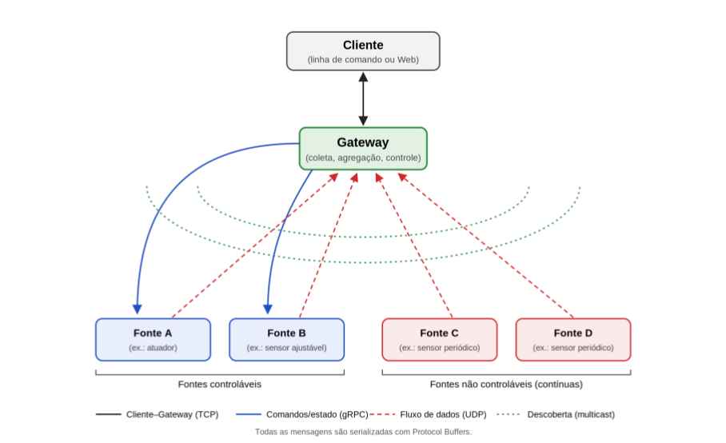

Distribuição de Processos e Dados Especificação do Trabalho: Gestão de Ambiente Inteligente Professor: Dr. Paulo A. L. Rego

## OBJETIVO

Desenvolver um sistema distribuído de monitoramento e controle, com foco em coleta e análise de dados, composto por um Gateway central, fontes de dados distribuídas e um Cliente para monitoramento, controle e consulta agregada dos dados gerados. O domínio de aplicação é escolhido pela equipe (veja a seção SUGESTÕES DE DOMÍNIOS DE APLICAÇÃO); a arquitetura, os protocolos e os requisitos são os mesmos para todos os domínios. Este trabalho visa consolidar conceitos de sistemas distribuídos por meio de:

- Comunicação entre processos usando sockets TCP e UDP.
- Serialização e intercâmbio de mensagens com Protocol Buffers.
- Invocação remota de procedimentos com gRPC.
- Descoberta de dispositivos utilizando multicast.

## DESCRIÇÃO GERAL

A Figura 1 ilustra a arquitetura genérica do sistema, que deve ser instanciada no domínio de aplicação escolhido pela equipe. Em seguida, são apresentadas as principais funções e requisitos de cada componente.

.

## Gateway

- Atua como o ponto central para coleta, agregação e monitoramento dos dados do domínio escolhido.
- Gerencia o estado e a configuração das fontes de dados via gRPC.
- Realiza a descoberta de fontes de dados por meio de multicast UDP.
- Recebe fluxos contínuos de dados gerados pelas fontes via UDP.
- Todas as comunicações utilizam Protocol Buffers (diretamente sobre sockets ou como definição dos serviços gRPC).

## Fontes de Dados

- Simulam as entidades do domínio escolhido que produzem dados ou executam ações, como sensores, atuadores, máquinas, veículos ou equipamentos.
- Participam do processo de descoberta por meio de multicast UDP.
- Enviam periodicamente leituras de dados ao Gateway ou, imediatamente, quando ocorrer um evento relevante (p. ex., ultrapassagem de limiar).
- As fontes controláveis expõem um serviço gRPC, por meio do qual recebem comandos do Gateway para ajustar parâmetros de operação (por exemplo, frequência de envio, limiar de alerta, intensidade, ligar/desligar) ou simular falhas.

## Cliente

- Implementado como um processo separado que interage com o Gateway via TCP, permite que o usuário:
- Consulte as fontes de dados conectadas e seus respectivos estados operacionais.
- Envie comandos de controle para fontes de dados específicas (por exemplo, ativar ou desativar uma fonte, alterar a frequência de envio de um sensor de 15 para 5 segundos, ajustar um limiar de alerta). Outros exemplos de configurações ficam a cargo da equipe.
- Execute consultas analíticas agregadas sobre os dados recebidos pelo Gateway.
- A interface de usuário pode ser em:
- Linha de Comando: Simples, com opções para listar fontes de dados, enviar comandos e executar consultas agregadas.
- Gráfica (Opcional): Um dashboard visual para exibição das fontes de dados, das séries temporais de leituras e do envio de comandos.

## SUGESTÕES DE DOMÍNIOS DE APLICAÇÃO

Cada equipe deve escolher um dos domínios abaixo ou propor outro, desde que atenda ao escopo mínimo definido no requisito 5. A tabela traz exemplos de papéis para cada componente; as equipes podem adaptá-los, acrescentar novos tipos de fontes e definir outras consultas.

|Domínio|Gateway|Fontes controláveis (comandos via gRPC)|Fontes contínuas (dados via UDP)|Exemplos de consultas agregadas|
|---|---|---|---|---|
|Cidade inteligente|Gateway urbano|Semáforo (tempo de ciclo); poste de iluminação (ligar/desligar, intensidade); sensor de qualidade do ar (limiar de alerta)|Estação meteorológica (temperatura, umidade); contador de tráfego; sensor de ruído|Média de temperatura na última hora; desvio padrão de CO2 nas últimas 24 h|

**Domínio Gateway**

|Telemetria de corrida|Central da equipe (pit wall)|Carro (modo de motor, chamada ao box, limite de consumo de combustível)|Sensor de pista (temperatura do asfalto, chuva); telemetria do carro (velocidade, RPM, temperatura dos pneus)|volta|
|---|---|---|---|---|
|Agricultura de precisão|Central da fazenda|Válvula de irrigação (abrir/fechar, vazão, horário); bomba do reservatório|Sensor de umidade do solo; estação meteorológica; sensor de nível do reservatório|Consumo de água por talhão nas últimas 24 h; talhão mais seco|
|Frota de drones de entrega|Estação de controle em solo|Drone (retornar à base, altitude, pausar missão, simular falha de motor)|Estação de vento; telemetria do drone (posição, bateria, altitude)|Autonomia média por drone; drone com maior consumo por km|
|Monitoramento de UTI|Central de enfermagem|Bomba de infusão (taxa de infusão, pausar)|Monitor multiparâmetro (frequência cardíaca, SpO2, pressão arterial)|Leito com mais alarmes na última hora; média de SpO2 por leito|
|Data center|Sistema de gerenciamento (DCIM)|Ar-condicionado de precisão (setpoint, velocidade da ventilação)|PDU (consumo por rack); sensores de temperatura e umidade dos racks|Rack mais quente; pico de consumo nas últimas 24 h|
|Indústria 4.0|Supervisório (SCADA/MES)|Esteira ou máquina CNC (velocidade, parar/retomar, trocar receita)|Sensor de vibração; contador de peças; sensor de temperatura do motor|Peças produzidas por hora; máquina com maior tempo parado|
|Evento ao vivo|Mesa de controle técnico|Refletor (intensidade, cor, cena); caixa de som (volume)|Medidor de nível sonoro (dB) por setor; catraca (contagem de público)|Pico de dB por setor; tempo acima do limite de ruído|

|Fontes controláveis|Fontes contínuas (dados|Exemplos de consultas|
|---|---|---|
|(comandos via gRPC)|via UDP)|agregadas|

#### Requisitos

1. **Comunicação e Serialização**:
a. O **Protocol Buffers** deve ser usado para serializar todas as mensagens trocadas:
i. Entre o Gateway e as Fontes de Dados (fluxo de dados via UDP e mensagens dos serviços gRPC). ii. Entre o Gateway e o Cliente.
b. A comunicação deve utilizar:
i. **TCP**: Mensagens entre o Cliente e o Gateway têm que utilizar sockets TCP. ii. **gRPC**: Comandos do Gateway para as fontes controláveis (e as respectivas respostas com o estado da fonte) têm que utilizar gRPC, com os serviços definidos em arquivos .proto. iii. **UDP:** Fluxos de dados das fontes para o Gateway devem usar UDP. iv. **UDP Multicast**: Para a descoberta inicial das fontes de dados.
2. **Fontes de Dados:**
a. Cada fonte de dados deve ser implementada como um processo separado, simulando o seu comportamento específico:
i. **Fonte Controlável:** Deve implementar um servidor gRPC que recebe comandos de configuração do Gateway e reporta seu estado operacional. Também envia seus dados ao Gateway via UDP. Exemplo: um atuador que pode ser ligado/desligado remotamente ou um sensor com limiar de alerta ou frequência de envio ajustáveis. ii. **Fonte não controlável (sensor contínuo):** Deve enviar leituras de dados de tempos em tempos ao Gateway via UDP. Exemplo: um sensor que envia periodicamente (por exemplo, a cada 15 segundos) suas leituras para o Gateway.

b. Os IPs e portas do Gateway e das Fontes de Dados devem ser descobertos por meio de multicast UDP, onde as fontes devem enviar seu:
i. Tipo (e.g., válvula de irrigação, sensor de vibração). ii. IP e porta (no caso das fontes controláveis, a porta do seu serviço gRPC). iii. Estado inicial (se aplicável).
c. Pelo menos uma das fontes deve ter comportamento controlável (i.e., recebe comandos para modificar parâmetros de operação, como, por exemplo, alterar a frequência de envio ou ativar/desativar a fonte).
3. **Cliente**:
a. Implementado como um processo separado que:
i. Conecta-se ao Gateway via TCP. ii. Solicita e exibe informações das fontes de dados conectadas e seus respectivos estados operacionais. iii. Envia comandos para configurar fontes de dados específicas.
b. Exemplo de comandos suportados:
i. Listar as fontes de dados conectadas e seus respectivos estados. ii. Ativar/desativar uma fonte de dados. iii. Realizar consultas analíticas agregadas no Gateway (por exemplo, média de uma grandeza na última hora, desvio padrão de uma leitura nas últimas 24 horas, fonte com maior variação nas leituras).
4. **Descoberta de Fontes**:
a. O Gateway deve enviar uma mensagem multicast UDP ao ser iniciado, solicitando que as fontes de dados se identifiquem.
b. As fontes de dados, ao receberem essa mensagem, devem responder com suas respectivas informações.
5. **Escopo Mínimo do Domínio**:
a. A equipe deve escolher um domínio da seção SUGESTÕES DE DOMÍNIOS DE APLICAÇÃO ou propor outro, informando-o na apresentação.
b. O sistema deve ter, no mínimo, três tipos distintos de fontes de dados, sendo pelo menos um controlável e pelo menos um não controlável.
c. Pelo menos um tipo de fonte deve enviar dados imediatamente ao detectar um evento relevante (p. ex., ultrapassagem de limiar), além do envio periódico.
d. O Cliente deve oferecer, no mínimo, três consultas analíticas agregadas distintas, adequadas ao domínio escolhido.

## INSTRUÇÕES DE ENTREGA

Os grupos podem ser formados por até 3 pessoas.

Um aluno de cada grupo deve enviar através de Formulário a ser fornecido, **até o dia 25/10/2026,** os seguintes dados para a entrega do trabalho:

1. Nome e número de matrícula dos membros do grupo;
2. Apresentação (slides) com o domínio de aplicação escolhido e os detalhes de implementação das três partes do trabalho, com foco no formato das mensagens trocadas entre os processos do sistema distribuído, na definição dos serviços gRPC, nas linguagens, frameworks e bibliotecas utilizados.
3. Anexar o arquivo .zip com o código-fonte do trabalho ou enviar o link do repositório público (Github ou Gitlab).
4. Apresentar um link para um vídeo de até 7 minutos que demonstre a execução do trabalho. O vídeo deve mostrar os processos sendo levantados, o cliente sendo executado, bem como eventuais situações, como o desligamento de uma fonte de dados, simulando uma falha.

## PONTUAÇÃO EXTRA

- Implementar o trabalho utilizando mais de uma linguagem de programação;
- Implementar persistência dos dados recebidos pelo Gateway (e.g., armazenamento em arquivo CSV ou banco de dados) e disponibilizar ao Cliente consultas sobre o histórico de leituras;
- Implementar o Cliente com interface gráfica (Web, Mobile) e visualização de séries temporais dos dados coletados;
