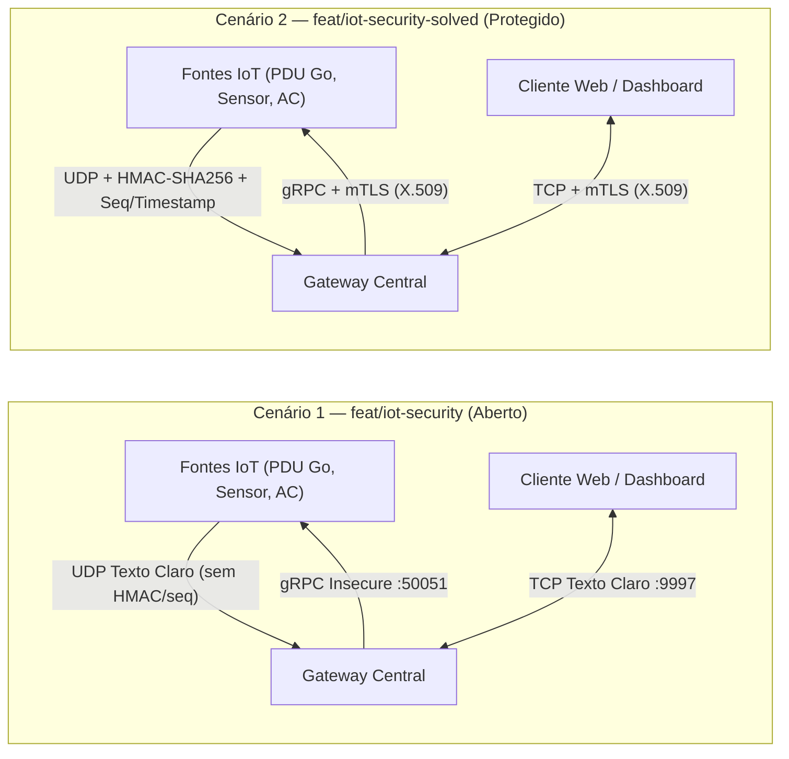

# Roteiro e Visão Geral da Demonstração — Redes 2 (Segurança em IoT)

Guia de alto nível para a apresentação prática do projeto **DataMesh DCIM** na disciplina de Redes de Computadores 2 (UFC), comparando o cenário vulnerável (`feat/iot-security`) com o cenário protegido (`feat/iot-security-solved`).

---

## 1. Visão Geral da Narrativa (Antes vs. Depois)



### Estrutura de Tempo (~12 minutos)

| Bloco | Duração | Foco | Branch |
| :--- | :---: | :--- | :--- |
| **1. Contextualização** | 2 min | Topologia IoT com servidor central e pilares de segurança | — |
| **2. Cenário Vulnerável** | 4 min | Evidenciar falhas práticas de confidencialidade, frescor e autenticação | `feat/iot-security` |
| **3. Cenário Protegido** | 4 min | Mostrar PKI/mTLS + HMAC/Anti-Replay barrando os mesmos vetores | `feat/iot-security-solved` |
| **4. Trade-offs e Fechamento** | 2 min | Custo de criptografia em IoT restrito vs. defesa em profundidade | — |

---

## 2. Organização da Tela na Apresentação

Para a turma acompanhar em tempo real sem troca constante de janelas:

- **Metade esquerda (Navegador):**
  - Dashboard principal (`http://localhost:8080`) com gráficos de potência/temperatura e status do AC.
  - Aba de topologia (`http://localhost:8080/network`) e eventos (`http://localhost:8080/events`).
- **Metade direita (2 terminais + Wireshark):**
  - **Terminal 1:** Console interativo da demo (`mise exec -- task demo` / `bash scripts/run_demo.sh`), permitindo disparar anomalia térmica `[1]` e sobrecarga elétrica de ~8000 W na PDU `[2]`.
  - **Terminal 2 / Wireshark:** Inspeção de pacotes na interface de loopback (`lo`) com filtro `udp.port == 9998 || tcp.port == 9997 || tcp.port == 50051` e testes de validação.

---

## 3. Roteiro Passo a Passo

### Ato 1 — Contexto e Arquitetura (2 min)
1. Explicar o papel de cada componente do DataMesh DCIM:
   - **Fontes heterogêneas:** PDU de Rack (Go), Sensor Térmico (Python) e Ar-Condicionado de Precisão (Python + gRPC).
   - **Servidor Central (Gateway):** descoberta via UDP multicast, ingestão UDP unicast, persistência SQLite, proxy gRPC e servidor TCP para o cliente.
   - **Cliente Web:** dashboard FastAPI + Chart.js.
2. Conectar com a disciplina: em ambientes IoT/industriais, o modelo de comunicação mistura **fluxo leve contínuo (UDP)** com **comandos críticos de atuação (gRPC/TCP)**. Sem proteção, cada protocolo expõe um pilar diferente da segurança.

---

### Ato 2 — Demonstração no Cenário Vulnerável (`feat/iot-security`) (4 min)

Subir o ambiente com:
```bash
git checkout feat/iot-security
mise exec -- task demo
```

#### Ponto A — Falta de Confidencialidade (Sniffing com Wireshark)
- **Ferramenta:** **Wireshark** na interface `lo` (Loopback).
- **Filtro:**
  ```text
  udp.port == 9998 || tcp.port == 9997 || tcp.port == 50051
  ```
- **Dica (Dissector Protobuf):** Em *Edit → Preferences → Protocols → Protobuf → Protobuf Search Paths*, apontar para a pasta `proto/` do repositório para decodificar os campos diretamente na interface.
- **O que a turma vê:** Os payloads Protobuf trafegam em texto claro; identificadores de dispositivos (`pdu-01-tesla`, `temp-01-turing`, `ac-01-carnot`) e métricas operacionais são legíveis diretamente no tráfego capturado.
- **Pilar violado:** **Confidencialidade**.

#### Ponto B — Falta de Integridade e Frescor (Mascaramento por Replay com Wireshark + `nc`)
- **Ferramentas:** **Wireshark** (exportação do payload UDP) + **`nc` (Netcat)**.
- **Passo a passo:**
  1. No Wireshark, selecionar um pacote UDP legítimo da `pdu-01-tesla` indo para a porta `9998` (~1400 W), clicar com o botão direito na camada **`Data`** → **Export Packet Bytes…** e salvar em `/tmp/pdu_normal.bin`.
  2. No console da demo (`run_demo.sh`), selecionar **`[2] Disparar sobrecarga elétrica (~8000 W) em uma PDU`** — o processo real da PDU entra em estado de sobrecarga crítica (`IsAlert=true`, ~8000 W por 30 s).
  3. Reenviar o pacote antigo em loop com `nc`:
     ```bash
     while true; do nc -u -w 0 127.0.0.1 9998 < /tmp/pdu_normal.bin; sleep 0.5; done
     ```
- **O que a turma vê:** Como o Gateway não valida assinatura, número de sequência nem janela de timestamp, o pacote antigo de ~1400 W sobrescreve o estado exibido no Dashboard ("câmera em loop" / estilo Stuxnet), ocultando a sobrecarga real.
- **Pilares violados:** **Integridade**, **Autenticidade** e **Frescor (Anti-Replay)**.

#### Ponto C — Falta de Autenticação na Atuação (gRPC Aberto com `grpcurl`)
- **Ferramenta:** **`grpcurl`** (cliente CLI padrão para gRPC).
- **Comando:**
  ```bash
  grpcurl -plaintext \
    -import-path proto -proto datamesh.proto \
    -d '{"device_id":"ac-01-carnot","power_on":false,"target_temp_c":28.0,"fan_speed_pct":0}' \
    127.0.0.1:50051 datamesh.AirConditionerService/SetControl
  ```
- **O que a turma vê:** Retorna `"success": true` e desliga o `ac-01-carnot` no Dashboard sem nenhuma credencial, ignorando o Gateway e sem trilha de auditoria.
- **Pilares violados:** **Autenticidade**, **Controle de Acesso**, **Disponibilidade** e **Não-Repúdio**.

---

### Ato 3 — Demonstração no Cenário Protegido (`feat/iot-security-solved`) (4 min)

Trocar para a branch protegida e subir novamente:
```bash
git checkout feat/iot-security-solved
mise exec -- task demo
```

#### Contramedida A — Integridade e Anti-Replay no UDP (IoT Leve)
- **Como foi resolvido:**
  - Cada datagrama UDP carrega **HMAC-SHA256** (chave pré-compartilhada) + **número de sequência monotônico (`seq_num`)** + **timestamp** com janela estrita (ex.: ±5 s).
- **O que a turma vê:**
  - Pacotes alterados são rejeitados por falha no HMAC.
  - Pacotes antigos reenviados são descartados imediatamente pelo Gateway com log de alerta de segurança (`Replay detected`), mantendo a sobrecarga real de ~8000 W visível no Dashboard.

#### Contramedida B — Confidencialidade e Autenticação Mútua no gRPC e TCP (Padrão Ouro: mTLS)
- **Como foi resolvido:**
  - Criação de uma **PKI / CA local** (`ca.crt`) emitindo certificados X.509 individuais para `gateway`, `ac` e `client`.
  - Tanto o gRPC (`:50051`) quanto o TCP (`:9997`) exigem **Mutual TLS (`mTLS`)**: servidor e cliente validam mutuamente seus certificados durante o handshake TLS.
- **O que a turma vê:**
  - No Wireshark, o tráfego TCP/gRPC aparece cifrado como `TLSv1.3 Application Data` (confidencialidade restaurada).
  - O mesmo comando `grpcurl -plaintext` (ou sem certificado de cliente) falha ainda no **TLS Handshake** (`UNAUTHENTICATED` / `TLS Fatal Alert`), impedindo o desligamento não autorizado do AC.
  - Passando os certificados emitidos pela CA, o comando autenticado funciona normalmente:
    ```bash
    grpcurl -cacert certs/ca.crt -cert certs/gateway.crt -key certs/gateway.key \
      -import-path proto -proto datamesh.proto \
      -d '{"device_id":"ac-01-carnot","power_on":true,"target_temp_c":20.0,"fan_speed_pct":70}' \
      127.0.0.1:50051 datamesh.AirConditionerService/SetControl
    ```

---

### Ato 4 — Quadro Comparativo Final e Conclusão (2 min)

| Aspecto | `feat/iot-security` | `feat/iot-security-solved` |
| :--- | :--- | :--- |
| **Wireshark (TCP/gRPC)** | Protobuf legível em texto claro | Tráfego cifrado (`TLS`) |
| **Pacote UDP alterado** | Aceito e persistido no SQLite | Rejeitado (falha de `HMAC-SHA256`) |
| **Pacote UDP antigo (Replay)** | Aceito; mascara sobrecarga real | Rejeitado (`seq_num` / janela de timestamp) |
| **Comando gRPC direto sem credencial** | Desliga o AC com sucesso | Bloqueado no handshake `mTLS` |
| **Auditoria / Não-Repúdio** | Inexistente | Identidade por certificado X.509 + logs de segurança |

**Mensagem de fechamento:**
- Em IoT real, **não existe mecanismo único para tudo**: dispositivos restritos em streaming contínuo usam autenticação leve (HMAC + contadores anti-replay), enquanto canais de controle e gerenciamento usam **mTLS com PKI (X.509)** — combinando desempenho e defesa em profundidade.
